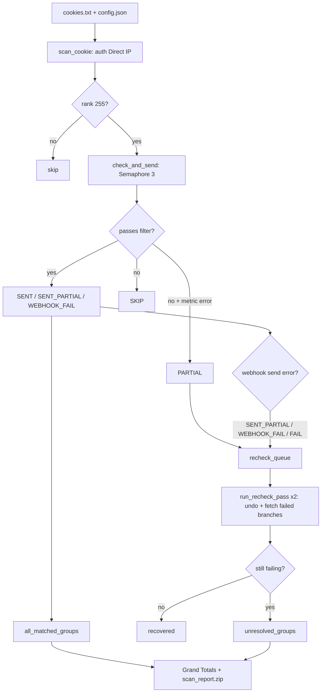

<div align="center">

# Roblox Owned Group Checker

**Asynchronously scan all Rank 255 groups from `.ROBLOSECURITY` cookies, with split auth Direct IP / public-over-Tor routing, live Discord embeds, and an in-RAM `scan_report.zip`.**

[](main.py)
[](requirements.txt)
[](#8-license)

</div>

## 1. Demo


Terminal preview (dashboard ANSI, `main.py`):

```text
ROBLOX GROUP OWNER SCANNER  v2.5.0
Status      : RUNNING

Target Acc  : LakoAcc01 (ID: 123456789)
Account Turn: 1/10
Group Queue : 14/42
Tor Network : Enabled (2 tunnels)
Filters     : R$100+ · pend 50+

-- METRICS ---------------------------------------------
  Owner Groups             42        Total Robux          15,400
  Filter Match              3        Pending Robux         4,200
  Skipped                  11        Partial Data              0

-- ACTIVITY --------------------------------------------
> 14:50:01  Account LakoAcc01 · ID 123456789 · 42 owner groups.
> 14:50:04  MATCH Group Alpha · id 1234567 · robux 12,000>=100 -> webhook ok

[Ctrl+C to stop]
```

Discord preview (actual output from `AccountStatus` + `send_grand_totals_webhook`):

```text
✅ [ACC 1/10] LakoAcc01
status  : FINISHED
checked : 42/42
robux   : 15,400
pending : 4,200
👑 Matched Groups (2)
• [1234567](https://www.roblox.com/groups/1234567) — 12,000 Robux · 4,000 Pending
• [8889999](https://www.roblox.com/groups/8889999) [⚠ LOST OWNERSHIP] — 3,400 Robux

💎 Grand Totals — All accounts
accounts: 10
groups  : 420
matched : 15
robux   : 85,000
pending : 12,500
combined: 97,500
📎 scan_report.zip (matched_groups.txt + unresolved_groups.txt)
```

Report style (1 group / 1 line, no table borders):

```text
# matched_groups.txt — sorted descending by robux+pending
https://www.roblox.com/groups/1234567 - LakoAcc01 - 12,000 Robux · 4,000 Pending
https://www.roblox.com/groups/8889999 - LakoAcc01 - 3,400 Robux · 25 Clothing

# unresolved_groups.txt
https://www.roblox.com/groups/4443332 - LakoAcc01
```

## 2. Features

- **Async engine (`asyncio` + `aiohttp`, `main.py` ~3,198 lines / 88 functions):** scans groups concurrently with `Semaphore(3)`, fetching 6 API branches (`currency`, `revenue`, `games`, `clothing`, `thumbnail`, `basic`) in a single guarded `gather` call with timeout protection.
- **Token-safe split session:** requests carrying `.ROBLOSECURITY` / `x-csrf-token` always go over the origin IP; public data (games, visits, clothing, group info) uses a bare session, routed through Tor when enabled.
- **Multi-instance Tor (`tor/tor_manager.py` + `tor/tor.exe`):** each account / re-check round uses a dedicated `IsolateSOCKSAuth` credential to force a fresh circuit and exit IP.
- **Rate-limit resistance:** `DomainPacer` paces requests per domain, doubles the interval on 429 and cools down after a success streak; 403 responses auto-heal by picking up the new `x-csrf-token` for retry.
- **Two-layer ownership verification:** filters `rank == 255`, then cross-checks `owner.userId` against `current_user_id`; groups stuck at rank 255 without real ownership are flagged `[⚠ LOST OWNERSHIP]` (`fake_own`).
- **2-round re-check:** `PARTIAL` / `SENT_PARTIAL` / `FAIL` / `WEBHOOK_FAIL` results are retried on failed branches only (`_ok`), with `_undo_result_stats` reverting old stats first so totals are never double-counted; preserves the invariant `checked_success + checked_failed == owned_groups`.
- **Compact reporting:** one auto-`PATCH`ed Discord message per account (`MAX_LISTED = 15`, sorted descending by `robux+pending`); one Grand Totals YAML embed at the end (6 core lines plus conditional `recheck/partial/failed/fake_own`) with `scan_report.zip` compressed in RAM via `io.BytesIO` + `zipfile` (no junk files on disk).
- **Verified:** `python -m py_compile main.py` passes; `test_status_embed.py` / `test_smoke.py` / `test_ui_dash.py` all report `ALL TESTS PASSED`.

## 3. Disclaimer & Security Warning

> [!CAUTION]
> **Read carefully before use:**
>
> - **Account-ban risk (Roblox ToS):** bulk scanning may trigger IP limits / account bans. This tool is for research and personal asset inventory. **The author is not responsible** for any account, Robux, or data loss.
> - **NEVER share tokens/cookies/passwords:** `.ROBLOSECURITY` grants full account access (bypasses 2FA). Never send `cookies.txt` or `config.json` (which contains your webhook URL) to anyone.
> - **Prevent secret leaks on git:** this repo currently has **no `.gitignore`**. Before `git init` / push, create a `.gitignore` containing at least:
>
> ```gitignore
> config.json
> cookies.txt
> .env
> proxies.txt
> tor/data/
> __pycache__/
> ```

## 4. Quick Start

Requirements: **Windows 10/11 + Python 3.9+** (verified working on Python 3.11.6).

```powershell
pip install -r requirements.txt
```

Actual dependencies (`requirements.txt`, 3 packages): `aiohttp>=3.9.0`, `rich>=13.7.0`, `psutil>=5.9.0`.

Prepare `cookies.txt` (one cookie per line, starting with `_|WARNING:-DO-NOT-SHARE-THIS.`, duplicates auto-filtered) and `config.json`:

```json
{
    "webhook_url": "YOUR_WEBHOOK_URL_HERE",
    "discord_id": "YOUR_DISCORD_ID_HERE",
    "status_embed": true,
    "terminal_ui": "dashboard",
    "tor": { "enabled": true, "amount": 2, "port": 10080 }
}
```

| Field | Type | Description |
| :--- | :--- | :--- |
| `webhook_url` | `string` | Discord webhook receiving embeds and `scan_report.zip`. |
| `discord_id` | `string` | User ID to ping as `<@id>` when a group passes the filters. |
| `status_embed` | `bool` | `true` = 1 live message/account; `false` = one-off webhook per group. |
| `terminal_ui` | `string` | `"dashboard"` (live ANSI) or `"classic"` (Rich log). |
| `tor.enabled/amount/port` | `bool/int/int` | Enable public Tor routing, tunnel count, starting SOCKS5 port. |

Run:

```powershell
python main.py
```

Then enter the filter thresholds in the wizard (Robux, Pending, Games, Visits, Clothing).

## 5. Directory Structure & Workflow

```text
Owned-group-check/
├── main.py              # Scanner v2.5.0: async engine, DomainPacer, UI, webhook, ZIP
├── config.json          # Webhook, Discord ID, UI, Tor (NEVER commit the real file)
├── cookies.txt          # Cookie input (NEVER commit the real file)
├── requirements.txt     # aiohttp, rich, psutil
└── tor/
    ├── __init__.py
    ├── tor_manager.py   # Lifecycle of N tor.exe processes, IsolateSOCKSAuth
    └── tor.exe          # Tor binary (Windows)
```

Runtime flow (`GroupScanner.start` in `main.py`):

```text
Input (cookies.txt + config.json + filter wizard)
  → scan_cookie per account (auth over Direct IP, public via Tor if enabled)
  → check_and_send per group (Semaphore 3, single atomic stats commit)
  → run_recheck_pass 2 rounds (undo old stats, fetch failed branches only)
  → send_grand_totals_webhook (compact YAML + in-RAM scan_report.zip)
Output (terminal dashboard + Discord embed/account + Grand Totals + ZIP)
```



## 6. Troubleshooting / FAQ

1. **`ModuleNotFoundError: No module named 'aiohttp'`**
   Dependencies missing or wrong interpreter. Run `python -m pip install -r requirements.txt` in the same venv, then retry `python main.py`.

2. **Bad cookie format / `401 Unauthorized`, account not scannable**
   Cookies must be full lines starting with `_|WARNING:-DO-NOT-SHARE-THIS.`. Cookies returning `401/403` are counted as `invalid_cookies` and skipped. Grab a fresh cookie and keep one cookie per line in `cookies.txt`.

3. **Expired token/CSRF (`403`, `x-csrf-token`) or proxy/Tor errors**
   The code auto-picks a fresh `x-csrf-token` from the `403` header for retry. If a Tor `port` is occupied or `tor/tor.exe` is missing, set `"tor": {"enabled": false}` to run fully on Direct IP.

4. **Rate-limit `429` / groups stuck at `PARTIAL`, scan slowing down**
   Expected when Roblox throttles an IP. `DomainPacer` auto-throttles; at the end `run_recheck_pass` rotates the exit IP and refetches only failed branches. Raise `tor.amount` (e.g. 2 → 5) for better distribution, and wait for the final ZIP instead of stopping early.

## 7. Connect & Support

- Discord: <https://discord.gg/rxw8Hwk3qA>
- TikTok: [@noxofusion](https://www.tiktok.com/@noxofusion)
- YouTube: [@noxofusion2010](https://www.youtube.com/@noxofusion2010)

## 8. License

MIT License.
